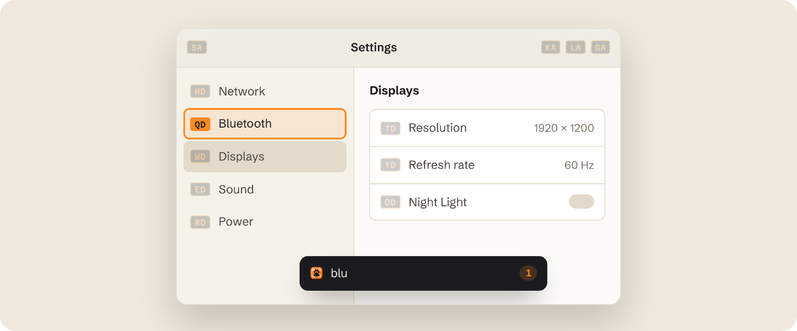
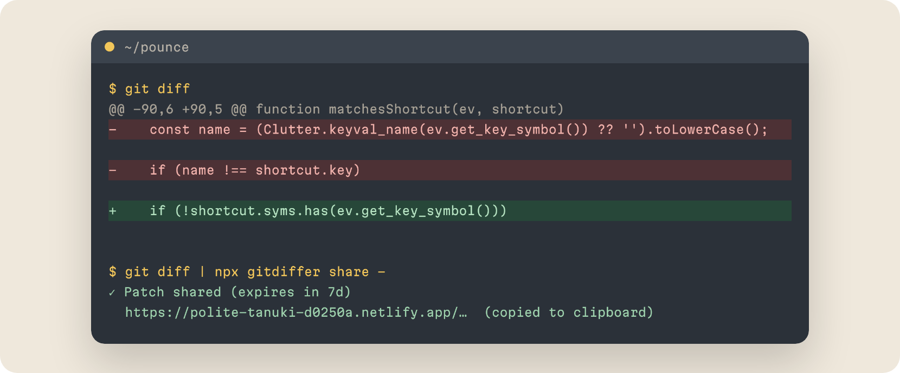

<a href="https://harshcom.in">
  <picture>
    <source media="(prefers-color-scheme: dark)" srcset="assets/header-dark.png">
    
  </picture>
</a>

*I build small tools whenever something slows me down twice.*

  <a href="https://harshcom.in"><picture><source media="(prefers-color-scheme: dark)" srcset="assets/pill-site-dark.png"></picture></a>
  <a href="https://harshcom.in/harsh-kr-gupta-resume.pdf"><picture><source media="(prefers-color-scheme: dark)" srcset="assets/pill-resume-dark.png"></picture></a>
  <a href="https://www.linkedin.com/in/hgupta7629"><picture><source media="(prefers-color-scheme: dark)" srcset="assets/pill-linkedin-dark.png"></picture></a>
  <a href="mailto:hgupta7629@gmail.com"><picture><source media="(prefers-color-scheme: dark)" srcset="assets/pill-email-dark.png"></picture></a>

### Things I've built

<a href="https://github.com/harsh1330/pounce">
  <picture>
    <source media="(prefers-color-scheme: dark)" srcset="assets/pounce-dark.png">
    
  </picture>
</a>

#### [pounce](https://github.com/harsh1330/pounce)

Click anything on a Linux desktop by typing. A two-letter code lands on every button, link and menu, in every window, the top bar and the dock.

- Works on Wayland, which gives apps no global screen coordinates
- Handles GTK4 and Electron reporting window positions differently

`JavaScript` `GNOME Shell` `Wayland` · [pounce.harshcom.in](https://pounce.harshcom.in)

 

<a href="https://github.com/harsh1330/gitdiffer">
  <picture>
    <source media="(prefers-color-scheme: dark)" srcset="assets/gitdiffer-dark.png">
    
  </picture>
</a>

#### [gitdiffer](https://github.com/harsh1330/gitdiffer)

Share a git diff by link, not by branch. A web app plus an npm CLI, used across the company I work at.

- No database: diffs live in Netlify Blobs and expire on their own
- The CLI explains why a patch won't apply, and falls back to a 3-way merge

`TypeScript` `Astro` `Netlify` · tested with Vitest and Playwright · [npm](https://www.npmjs.com/package/gitdiffer) · [live site](https://polite-tanuki-d0250a.netlify.app)
